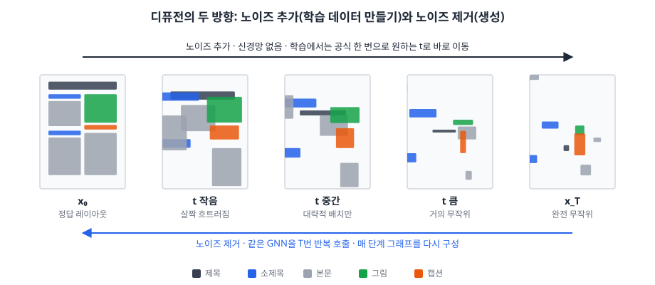
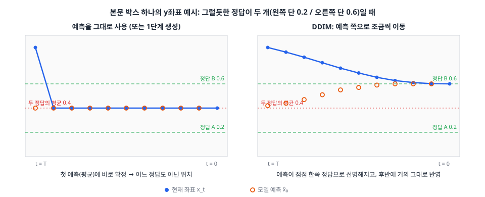
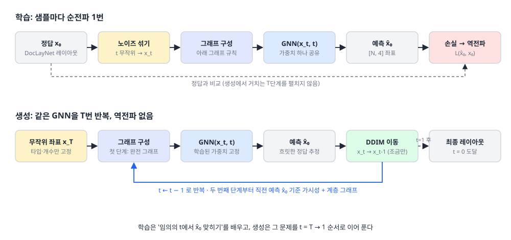
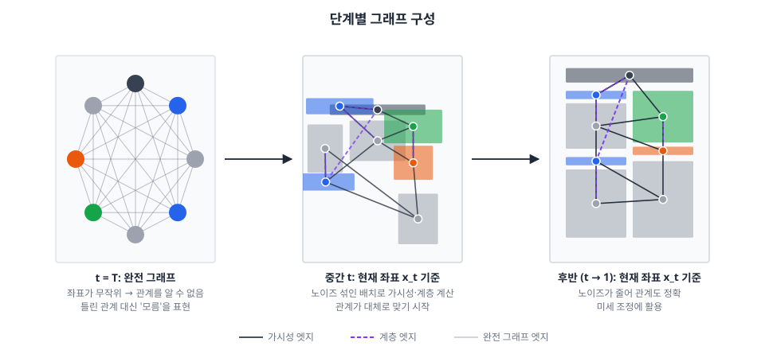

# 모델 설계: 관계 그래프 기반 GNN 디퓨전

> 주제·연구 질문·평가는 [README.md](README.md), 목적함수는 [obj-function.md](obj-function.md) 참고. 2026-11-05 ~ 11-08 논의 정리.

---

## 1. 개요



- **입력**: 순서 없는 타입별 개수 (`소제목 3, 본문 5, 그림 1`)
- **출력**: 노드별 x, y, w, h → [N, 4]
- **방식**: 무작위 좌표에서 시작해 같은 GNN을 T번 반복 호출하며 노이즈를 조금씩 제거 (DDIM)
- **그래프**: 첫 단계는 완전 그래프, 이후는 직전 예측 좌표 기준 가시성·계층 그래프

**왜 디퓨전인가**: 같은 타입 노드는 피처가 같고 정답(레이아웃)이 여러 개라, 일반 회귀 GNN은 정답들의 평균으로 뭉개진다. 노드마다 무작위 초기 좌표를 주고(같은 타입 노드를 구분하는 유일한 요소) 반복적으로 노이즈를 제거한다.

| 표기 | 의미 |
|---|---|
| x₀ | 정답 좌표 (DocLayNet 레이아웃) |
| x₁ ~ x_T | 노이즈 섞인 좌표 (숫자가 클수록 노이즈 많음, x_T는 완전 무작위) |
| x̂₀ | 모델이 예측한 정답 좌표 |

---

## 2. 디퓨전 원리

### 2.1 핵심 직관: 왜 여러 번 나눠서 이동하나

모델의 예측은 항상 **"현재 상태와 어울리는 정답들의 평균"**이다. 달라지는 것은 평균을 내는 대상이다.

| | 평균을 내는 정답들 | 결과 |
|---|---|---|
| **한 번에 이동** | 노이즈가 많은 시점이라 천차만별인 전체 정답 | 어느 정답도 아닌 평균 (뭉개짐) |
| **여러 번 이동** | 매 시점, 현재 상태와 비슷한 정답들 | 점점 특정 정답에 가까워짐 |



예: 본문 y좌표의 정답이 0.2(왼쪽 단)와 0.6(오른쪽 단) 두 개, 시작 좌표 0.9

```
예측 그대로 사용                          DDIM (조금씩)
t=50: 입력 0.9 → 예측 0.4 → 0.4로         t=50: 입력 0.9  → 예측 0.4  → 0.85로
t=49: 입력 0.4 → 50:50 → 예측 0.4         t=49: 입력 0.85 → 위쪽 치우침 → 예측 0.44
...   0.4에서 멈춤 (어느 정답도 아님)      ...   0.6으로 수렴
```

- 조금만 이동하면 초기 무작위 좌표의 **치우침(단서)**이 남아, 예측이 한쪽 정답으로 기울고 → 다음 이동도 그쪽으로 가는 되먹임이 생긴다.
- 즉 조금씩 이동하는 과정은 **평균을 내는 정답의 범위를 점점 좁혀가는 과정**이다.

### 2.2 학습: x_t에서 정답으로 한 번에



```
for 레이아웃 in 데이터:
    t = 무작위(1 ~ T)                              # 샘플마다 하나만 뽑음
    x_t = √ᾱ(t) × x₀ + √(1−ᾱ(t)) × ε               # 입력 좌표에만 노이즈를 섞음
    x̂₀ = GNN(x_t, t, 그래프)                        # 그래프는 4장
    손실 = 목적함수(x̂₀, x₀) → 역전파
```

- **한 데이터를 T번 반복하지 않는다.** 데이터·epoch이 쌓이며 모든 노이즈 크기를 골고루 본다. 학습 비용은 일반 모델과 거의 같다.
- **단계적 복원이 아니라 한 번에 복원**을 배운다. 어떤 t든 목표는 항상 x₀다. ("37 → 36 한 칸 이동"은 배우지 않음)
- **노이즈는 입력 좌표에만** 샘플마다 1번 섞는다. 히든 레이어에는 섞지 않는다.
- **t를 입력으로 준다.** 모델은 하나의 함수 f(x_t, t)이고, t에 따라 하는 일이 달라진다.

| t | 입력 상태 | 모델이 하는 일 |
|---|---|---|
| 큼 | 거의 무작위 | 초안: 타입·개수만 보고 대략적 배치 (흐릿함) |
| 중간 | 대략적 배치 | 구조 정리: 단 나누기, 위계 순서 |
| 작음 | 살짝 흐트러짐 | 미세 조정: 정렬, 겹침 제거 |

- t 임베딩: 사인/코사인 16차원. 노드 피처에만 붙일지, 각 메시지 전달 레이어에도 더할지 실험으로 결정.
- **모든 노이즈 수준을 학습해야 한다.** 생성은 완전 무작위에서 시작하므로, 작은 노이즈만 학습하면 생성이 안 된다. (현재 `train.py`는 노이즈 0.03 하나 → 다단계로 변경)

### 2.3 생성: DDIM으로 조금씩 이동

```
x_T = 완전 무작위 좌표 (타입·개수 고정)
for t = T, ..., 1:                                  # t는 반복문 카운터
    x̂₀ = GNN(x_t, t, 그래프)
    노이즈 성분 = (x_t − √ᾱ(t) × x̂₀) ÷ √(1 − ᾱ(t))
    x_{t-1} = √ᾱ(t−1) × x̂₀ + √(1 − ᾱ(t−1)) × 노이즈 성분
출력: x₀
```

- **생성 중에 정답은 없다.** 섞는 것은 모델 예측 x̂₀와 현재 좌표의 노이즈 성분(초기 치우침이 담긴 부분)이다.
- **t는 측정값이 아니라 스케줄상 단계**다. x_T는 정의상 순수 노이즈이고, DDIM은 결과가 정확히 t−1 수준의 노이즈가 되도록 섞는다 → 매 단계 입력이 학습 때 본 x_{t-1}과 같은 형태.
- t가 클 때는 예측을 조금만, 작을수록 거의 그대로 반영한다. 생성 중 가중치는 업데이트하지 않는다.
- **예측을 그대로 쓰면 안 되는 이유**: ① 다음 입력이 학습 때 본 적 없는 형태(노이즈 없는 평균)가 되고, ② 같은 타입 노드가 한곳에 뭉쳐 다시 갈라지지 않는다.
- **단계 수**: DDIM은 재학습 없이 바꿀 수 있다. T = 1 / 5 / 10 / 50 비교 실험 (T = 1이면 평균으로 뭉개지는지 확인).

### 2.4 학습 1번 · 생성 T번이 맞물리는 이유

| | 순전파 | 역전파 | 그래프 구성 |
|---|---|---|---|
| 학습 | 샘플당 1번 (self-conditioning 시 +1) | 1번 | 1번 |
| 생성 | T번 | 없음 | T번 |

- 역할 분리: **정답 추정은 모델**, **조금씩 이동은 고정 공식(DDIM)**. 학습은 모든 t를 고르게, 생성은 그 t들을 순서대로 밟는다.
- **노출 편향**: DDIM은 "예측 = 정답"을 가정하므로 예측 오차만큼 입력이 학습 분포에서 벗어나 누적될 수 있다. self-conditioning(4.2)이 일부 완화하고, 필요하면 학습 노이즈 섭동·단계 수 조절로 대응.

---

## 3. 입력 피처 (39차원)

| 구분 | 피처 | 차원 |
|---|---|---|
| 노드 (고정) | 타입 one-hot | 9 |
| 전역 (고정) | 타입별 개수 / 총 요소 수 | 9 / 1 |
| 현재 상태 | x_t의 x, y, w, h | 4 |
| 현재 상태 | t 임베딩 (사인파) | 16 |

- 선택: 직전 예측 x̂₀(4차원)를 피처로도 추가 → 43차원 (실험으로 결정)
- **제외**: 중요도·종횡비(정답에서 계산 → 유출), 읽기 순서(입력에 없음), 텍스트 분량·단락 여부(콘텐츠 미입력), 트리 깊이·자식 수(계층 엣지와 중복)
- 기준: **노이즈 좌표나 모델 예측에서 계산한 값은 사용 가능, 정답 좌표에서 계산한 값은 불가.**

---

## 4. 그래프 구성



### 4.1 결정

관계(가시성·계층)는 입력이 아니라 **좌표에서 나오는 기하 관계**다. 입력이 개수뿐이라 생성 초반에는 관계 정보가 없고, 노이즈 좌표로 만든 엣지는 틀린 관계다. 그래서 **관계를 어떤 좌표에서 계산할지**를 정했다.

| 단계 | 그래프 | 근거 |
|---|---|---|
| 첫 단계 (t = T) | **완전 그래프** | 관계를 알 수 없는 시점. 틀린 관계 대신 "모름"을 표현 |
| 이후 | **직전 예측 x̂₀ 기준 가시성 + 계층** | 노이즈 좌표보다 모델의 최선 추정이 훨씬 정확. 예측이 선명해질수록 관계도 정확 |

- 기존 `generate_adj.py`(엣지)·`generate_attr.py`(엣지 속성 15차원)를 그대로 쓰되 입력 좌표만 x̂₀로 바꾼다.
- 엣지 속성에 **엣지 종류 플래그**(완전 / 관계) 추가. 완전 그래프 엣지의 기하 속성은 0.
- 학습과 생성에서 같은 그래프 구성 규칙을 사용한다.

### 4.2 학습: self-conditioning

```
확률 50%:  그래프 = 완전 그래프                                  # 첫 단계 상황
확률 50%:  x̂₀_prev = GNN(x_t, t, 완전 그래프)  (기울기 없이)
           그래프 = 가시성·계층(x̂₀_prev)                         # 이후 단계 상황
x̂₀ = GNN(x_t, t, 그래프) → 손실 → 역전파
```

- self-conditioning(Analog Bits, Chen et al. 2022)을 그래프 구성에 응용. 학습 약 1.5배 느려짐.
- 모델이 자기 예측의 오차를 학습 때 경험해 노출 편향이 줄어든다.

### 4.3 제외한 방식

| 방식 | 제외 이유 |
|---|---|
| 매 단계 노이즈 좌표 x_t 기준 (최초 설계) | t가 클 때 무작위 그래프 = 틀린 관계 |
| 입력 순서·캡션 짝 기반 고정 엣지 | 입력이 순서 없는 개수라 불가 (입력 명세를 바꾸면 향후 가능) |
| 타입 기반 고정 엣지 | 타입은 이미 노드 피처에 있어 추가 정보 없음 |
| 전체를 완전 그래프로 | 관계 정보 없음 (≈ Transformer). 주제와 맞지 않음 → 비교군으로만 |
| t > τ에서만 완전 그래프 | τ를 따로 정해야 하고 그래프가 급변 |

### 4.4 ablation (연구 질문 2)

| 조건 | 확인하는 것 |
|---|---|
| 완전 그래프만 | 관계 정보 없이도 되는가 |
| 가시성만 / 계층만 / 둘 다 | 각 관계의 기여 |
| 관계를 x_t 기준 vs x̂₀ 기준 | 관계를 어디서 계산하느냐의 효과 |
| 첫 단계 가시성 vs 완전 그래프 | 첫 단계 선택의 근거 |

- **위험 요소**: "완전 그래프만"이 "가시성 + 계층"과 비슷하면 관계 그래프 효과 주장이 약해진다 → 반드시 포함.

---

## 5. 목적함수

> 상세 설계와 실험 계획은 **[obj-function.md](obj-function.md)** 참고.

```
L = L_복원 + λ_겹침(t) × L_겹침 + λ_이탈 × L_이탈 + λ_정렬(t) × L_정렬
```

- 출력을 노이즈 ε가 아니라 좌표 x̂₀로 직접 예측하므로 기하 손실을 바로 적용할 수 있다.
- 손실 가중치는 항마다 따로 둔다. 겹침·정렬은 ᾱ(t)로 t에 따라 바꾸고, 이탈은 고정.
- 실험 3가지: ① L_복원만 / ② + 기하 손실(고정 손실 가중치) / ③ + 기하 손실(겹침·정렬에 ᾱ(t) 적용)

---

## 6. 구현 할 일

- [ ] 피처 재구성 (39차원, t 임베딩 위치: 입력만 vs 레이어마다)
- [ ] 노이즈 스케줄 ᾱ(t) 구현 (cosine 스케줄로 시작)
- [ ] 그래프 구성: 완전 그래프 + 엣지 종류 플래그, `generate_adj.py`·`generate_attr.py`를 x̂₀ 입력으로 호출
- [ ] 학습 코드 수정 (다단계 노이즈 + t 임베딩 + self-conditioning + 배치 마스크)
- [ ] 목적함수 실험 ①②③ 구현 ([obj-function.md](obj-function.md) 3절)
- [ ] DDIM 기반 반복 생성 루프 구현 (단계 수 가변)
