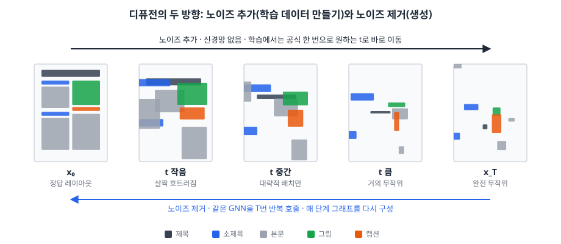

# 졸업논문 주제

> 현재 프로젝트 자산(가시성·계층 그래프 구성, Dual-Branch LayoutGNN, DocLayNet 학습 파이프라인, LLM 최적화 백엔드, A4 렌더러)을 기준으로 정리. 상단은 확정 주제, 하단은 검토했던 후보 10개.
> 공통 전제: 정량 평가가 가능해야 하고, LLM이 아니라 **내 모델/방법이 주인공**이어야 한다.

---

# ✅ 확정 주제 (2026-11-08)

> 2026-11-05 ~ 11-08 논의 결과. 세부 실험은 추후 확장.

## 제목

**관계 그래프 기반 GNN 디퓨전을 이용한 문서 레이아웃 생성과 정합성 확보: 가시성·계층 관계와 손실 설계의 효과 분석**

## 한 줄 요약

사용자가 요소 타입별 개수("소제목 3, 본문 5, 그림 1")만 주면, LLM 없이 GNN만으로 무작위 좌표에서 시작해 매 단계 직전 예측 좌표로 가시성·계층 그래프를 다시 구성하며 노이즈를 제거해, 기하·구조·분포 정합성을 갖춘 한 페이지 레이아웃을 생성한다.

## 연구 질문

1. LLM 없이 GNN만으로 실제 문서 수준의 기하·구조·분포 정합성을 갖춘 레이아웃을 생성할 수 있는가?
2. 가시성·계층 엣지는 각각 어떤 정합성에 기여하는가?
3. 겹침·이탈·정렬 손실과 그 가중치 스케줄은 정합성에 어떤 영향을 주는가?

## 범위

| 항목       | 결정                | 이유                                                              |
| -------- | ----------------- | --------------------------------------------------------------- |
| 생성 대상    | 레이아웃(x, y, w, h)만 | 콘텐츠를 받으면 의미 단위 분할까지 필요해 범위가 과도함                                 |
| 생성 주체    | GNN 단독            | LLM 초기화 + GNN 보정 구조에서는 정합성의 공을 구분할 수 없음                         |
| 페이지      | 단일 페이지            | 학습 데이터(DocLayNet)와 표준 과제(Gen-T)가 페이지 단위. 다중 페이지는 향후 연구          |
| 노드 단위    | 문단 수준 블록          | "본문 5" = 문단 5개. 페이지당 약 10~20개 (DocLayNet 평균 13~14개, 측정으로 확인 예정) |
| LLM 비교   | 하지 않음             | 관련 연구·한계점에서 범위를 밝히는 것으로 처리                                      |
| 기존 파이프라인 | 유지                | LLM + GNN 서비스는 삭제하지 않음                                          |

## 사용자 입력

순서 없는 타입별 개수만 입력한다.

```
소제목 3, 본문 5, 그림 1
```

- 같은 타입 노드는 피처가 같아서, 일반 회귀 GNN은 같은 좌표를 출력하고 정답이 여러 개인 문제에서 평균으로 뭉개짐
- 따라서 노드마다 무작위 초기 좌표를 주고 반복적으로 노이즈를 제거하는 **디퓨전 방식 생성 모델**로 설계

## 모델 개요

> 모델 구조, 디퓨전 학습·생성 방식, 그래프 구성, 목적함수는 **[MODEL.md](MODEL.md)**에 정리.



- **방식**: 무작위 좌표에서 시작해 같은 GNN을 T번 반복 호출하며 노이즈를 조금씩 제거 (DDIM)
- **그래프**: 첫 단계는 완전 그래프, 이후 단계는 직전 예측 좌표 기준 가시성·계층 그래프
- **목적함수**: 복원 손실 중심 + 단계 t에 따라 커지는 겹침·이탈·정렬 손실

## 평가

### 정량 지표

**A. 기하 정합성** (학습에도 사용)

| 지표 | 정의 | 방향 |
|---|---|---|
| 겹침 (Overlap) | 모든 박스 쌍의 교집합 면적 합 ÷ 쌍의 수 | 낮을수록 좋음 |
| 정렬 (Alignment) | 각 박스의 좌·중앙·우 x좌표가 다른 박스와 가장 가까운 거리의 평균 (LayoutGAN++ 정의) | 낮을수록 좋음 |
| 페이지 이탈 | 0~1 범위를 벗어난 박스 비율 | 낮을수록 좋음 |

**B. 구조 정합성** (평가에만 사용, 이 연구 고유 지표)

| 지표 | 정의 | 방향 |
|---|---|---|
| 캡션 인접률 | 캡션 중 가장 가까운 그림/표와의 거리가 임계값 이하인 비율 | 높을수록 좋음 |
| 위계 순서 준수율 | 같은 단 안에서 본문 위쪽에 소제목·제목이 있는 비율 | 높을수록 좋음 |
| 단 일관성 | 같은 단에 속한 박스들의 너비가 비슷한 정도 | 높을수록 좋음 |

**C. 분포 정합성** (평가에만 사용)

| 지표 | 정의 | 방향 |
|---|---|---|
| 박스 분포 거리 (메인) | 타입별 x, y, w, h 분포와 실제 문서 분포의 Wasserstein 거리 | 낮을수록 좋음 |
| 최대 IoU (Max IoU) | 같은 타입 구성의 실제 문서와 가장 잘 맞을 때의 IoU | 높을수록 좋음 |
| FID (선택) | 레이아웃 특징 공간에서 실제 분포와의 거리. 특징 추출 모델을 따로 학습해야 함 | 낮을수록 좋음 |

- 같은 입력에도 매번 다른 레이아웃이 나오는 게 정상 → 정답 하나와의 비교보다 분포·기하·구조 정합성 중심으로 평가
- B를 학습에 넣지 않았는데도 좋아지면 그래프 구성 덕분이라고 주장 가능 (연구 질문 2)
- C는 박스 축소 같은 편법을 잡아냄

### 비교 기준

- **하한**: 무작위 배치, 규칙 기반 배치, MLP (그래프 없음)
- **상한**: 실제 DocLayNet 문서의 지표 값
- **내부 비교 (연구 질문 2, 3)**
  - 그래프 구성: 완전 그래프 / 가시성만 / 계층만 / 가시성+계층, 관계를 노이즈 좌표와 예측 좌표 중 어디서 계산하는지 (상세: [MODEL.md](MODEL.md) 4.4)
  - 손실 구성: λ = 0 / 고정 / t에 따라 변화
  - 반복 횟수: T = 1, 5, 10, 50 (T = 1이면 평균으로 뭉개지는지 확인)

### GNN을 쓰는 이유 (실험으로 증명할 가설)

- **관계 그래프의 효과**: 가시성·계층 엣지가 정합성을 실제로 높이는가
- **요소 수 일반화**: 작은 문서로 학습하고 큰 문서에서도 성능이 유지되는가 (MLP는 고정 입력 크기라 이 실험 자체가 불가)
- **데이터 효율**: 적은 학습 데이터로도 학습이 잘 되는가
- **경량성**: 파라미터 수, 생성 시간, 메모리 (현재 체크포인트 약 185만 파라미터 추정, 측정 필요)
  - "저렴하다"는 표현은 쓰지 않고 측정한 수치로만 서술
- 보안(로컬 처리)은 동기 부분의 보조 근거로만 사용

## 향후 확장 (현재 범위 밖)

- 다중 페이지 레이아웃
- 요소별 텍스트 분량 조건 ("본문 1: 약 300자" 형식의 숫자 입력)
- 그림 종횡비 조건 (업로드한 이미지 비율)
- 사용자 관계 제약 ("이 그림은 이 본문 옆에" → 엣지로 입력)
- 문서 유형 조건

## 다음 할 일

- [ ] 평가 코드 구현 (A 기하, B 구조, C 분포 정합성 측정기)
- [ ] DocLayNet 실제 문서의 지표 값과 페이지당 요소 수 분포 측정 (상한 기준, 실험 범위 결정)
- [ ] 모델 구현 (세부 항목: [MODEL.md](MODEL.md) 6장)

## 검토 후 제외한 방향

| 방향 | 제외 이유 |
|---|---|
| 겹침만으로 평가 | 박스를 줄이는 편법으로 0을 만들 수 있음, 현재 LLM 레이아웃도 거의 겹치지 않음 |
| LLM 재요청 반복 횟수 측정 | 논문의 주인공이 LLM이 됨 |
| LLM 초기 레이아웃 보정 | 정합성의 공이 LLM인지 GNN인지 구분 불가 |
| 보안을 메인 근거로 | 개수 입력은 LLM에 보내도 유출이 없고, 로컬 LLM으로도 해결되며 정량화가 어려움 |
| 콘텐츠 입력 | 의미 단위 분할이 필요해 범위가 과도함 |
| 평가 지표를 그대로 목적함수로 사용 | 미분 불가능한 지표가 있고, 편법과 순환 평가 문제 발생 |
| 다중 페이지 생성 | 학습 데이터가 페이지 단위라 모델이 페이지 구분을 배울 수 없음 |
