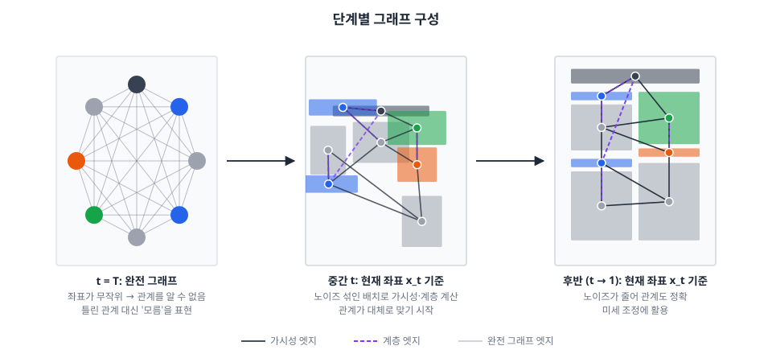

# 그래프 구성

> 모델 전체 구조는 [model.md](model.md), 목적함수는 [obj-function.md](obj-function.md) 참고. 2026-11-08 논의 정리.

---



## 1. 결정

```
t = T  → 완전 그래프
t < T  → 현재 노이즈 좌표 x_t 기준 가시성 + 계층 그래프
```

**학습과 생성에 똑같이 적용**한다. 확률로 섞지 않고 t만 보고 그래프가 정해진다.

| 단계 | 그래프 | 근거 |
|---|---|---|
| t = T | **완전 그래프** | x_T는 순수 노이즈라 관계를 알 수 없음. 틀린 관계 대신 "모름"을 표현 |
| t < T | **x_t 기준 가시성 + 계층** | 노이즈 좌표로 바로 구성. 학습과 생성이 완전히 같은 방식이라 불일치가 없음 |

- 기존 `generate_adj.py`(엣지)·`generate_attr.py`(엣지 속성 15차원)를 그대로 쓰되 입력 좌표를 x_t로 둔다. 가시성 판정 기준, 단 분리 기준, 엣지 속성 정규화까지 학습·생성에서 동일하게 한다.
- 엣지 속성에 **엣지 종류 플래그**(완전 / 관계) 추가. 완전 그래프 엣지의 기하 속성은 0.
- **정답 x₀로 그래프를 만들지 않는다.** 정답의 이웃 관계·상대 거리가 엣지로 새어 들어가고(정답 유출), 생성에는 정답이 없어 학습·생성이 어긋난다.

### 이 방식의 장단점

| 장점 | 단점 |
|---|---|
| 학습·생성이 완전히 일치 | T에 가까운 t(예: T−1)에서는 x_t가 거의 무작위라 관계 그래프도 무작위에 가까움 |
| 1차 예측·보조 손실·확률 혼합이 필요 없어 구조가 단순 | |
| 학습 비용 1배 (순전파 1번) | |

단점이 생각보다 작을 수 있는 이유:
- 학습 때도 같은 상황을 보므로, 모델이 t 임베딩을 보고 **t가 크면 엣지를 덜 믿는 법**을 배울 수 있다.
- t가 클 때 DDIM은 조금씩만 움직여 이 단계 예측이 결과에 주는 영향이 작다.
- t가 작아질수록 x_t가 정답에 가까워져 그래프도 자연스럽게 정확해진다.

## 2. 학습

```
t = 무작위(1 ~ T)
x_t = √ᾱ(t) × x₀ + √(1−ᾱ(t)) × ε
그래프 = 완전 그래프          if t = T
         가시성·계층(x_t)     otherwise
x̂₀ = GNN(x_t, t, 그래프) → 손실 → 역전파
```

## 3. 개선안 (필요 시)

기본 방식으로 학습·평가한 뒤, **큰 t의 무작위 그래프가 실제로 성능을 떨어뜨리면** 아래를 순서대로 시도한다.

### 3.1 T 근처 몇 단계까지 완전 그래프

```
t ≥ T − k  → 완전 그래프
t < T − k  → 가시성·계층(x_t)
```

- 확률이 아니라 t로 정해지는 규칙이며 학습·생성에 똑같이 적용한다. 기본은 k = 0.

### 3.2 예측 좌표 x̂₀ 기준 (self-conditioning)

관계 그래프를 노이즈 좌표 대신 모델 예측으로 만든다. 생성에서는 직전 단계 예측을 쓰고, 학습에서는 1차 예측을 먼저 한다.

```
t = T:  손실 = L(GNN(x_t, t, 완전 그래프))
t < T:  x̂₀_1 = GNN(x_t, t, 완전 그래프)                         ← 1차 예측 (관계 그래프 재료)
        x̂₀_2 = GNN(x_t, t, 가시성·계층(x̂₀_1.detach()))          ← 관계 그래프로 학습
        손실 = L(x̂₀_2) + 0.2 × L(x̂₀_1)
```

- 큰 t에서도 흐릿하지만 대략적인 배치를 반영한 그래프를 쓴다.
- 1차 예측은 t < T에서도 완전 그래프로 돌아가므로, 그 품질을 유지하려면 보조 항 `0.2 × L(x̂₀_1)`이 필요하다.
- 학습·생성 사이에 작은 차이가 남는다 (학습은 같은 t의 예측, 생성은 직전 t+1의 예측으로 그래프 구성).
- 학습 비용 약 2배. self-conditioning(Analog Bits, Chen et al. 2022)을 그래프 구성에 응용한 형태.

## 4. 제외한 방식

| 방식 | 제외 이유 |
|---|---|
| 정답 x₀ 기준 그래프 | 정답 유출, 생성에서 재현 불가 |
| 모든 t에서 확률로 완전 그래프 혼합 (50% 등) | x̂₀ 기준에서 1차 예측용으로 검토했던 방식. 생성에서 완전 그래프는 t = T뿐이라 비중이 과다하고, x_t 기준에서는 필요 없음 |
| 입력 순서·캡션 짝 기반 고정 엣지 | 입력이 순서 없는 개수라 불가 (입력 명세를 바꾸면 향후 가능) |
| 타입 기반 고정 엣지 | 타입은 이미 노드 피처에 있어 추가 정보 없음 |
| 전체를 완전 그래프로 | 관계 정보 없음 (≈ Transformer). 주제와 맞지 않음 → 비교군으로만 |

## 5. ablation (연구 질문 2)

| 조건 | 확인하는 것 |
|---|---|
| 완전 그래프만 | 관계 정보 없이도 되는가 |
| 가시성만 / 계층만 / 둘 다 | 각 관계의 기여 |
| 관계를 x_t 기준 (기본) vs x̂₀ 기준 (3.2) | 관계를 어디서 계산하느냐의 효과 |
| k = 0 vs k > 0 (3.1) | T 근처 무작위 그래프의 영향 |

- **위험 요소**: "완전 그래프만"이 "가시성 + 계층"과 비슷하면 관계 그래프 효과 주장이 약해진다 → 반드시 포함하고, 초반에 먼저 돌려 본다.
