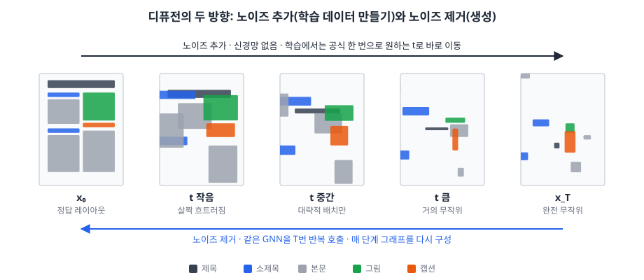
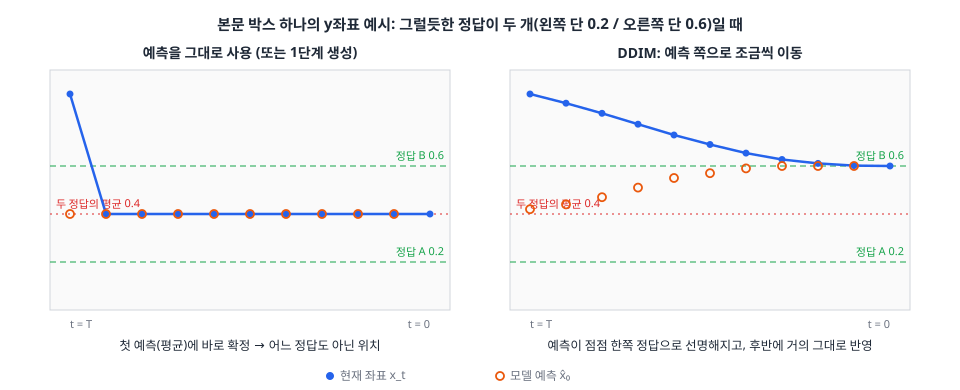
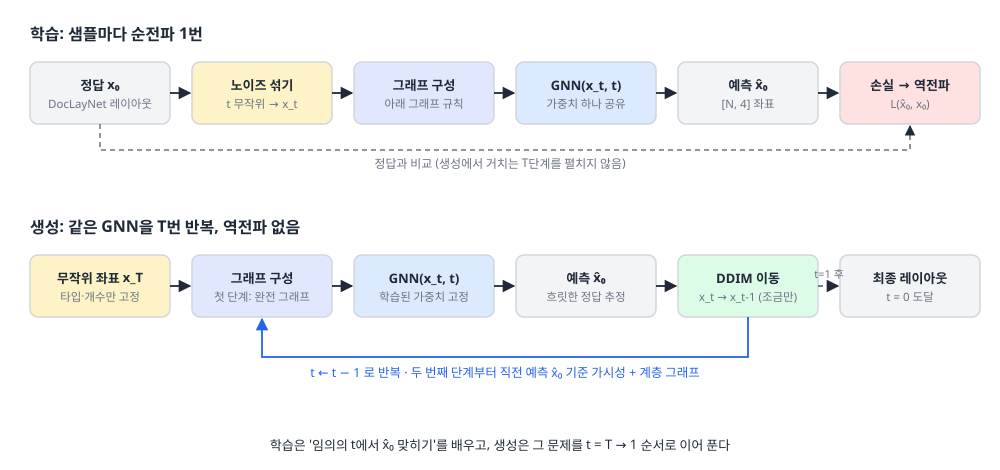
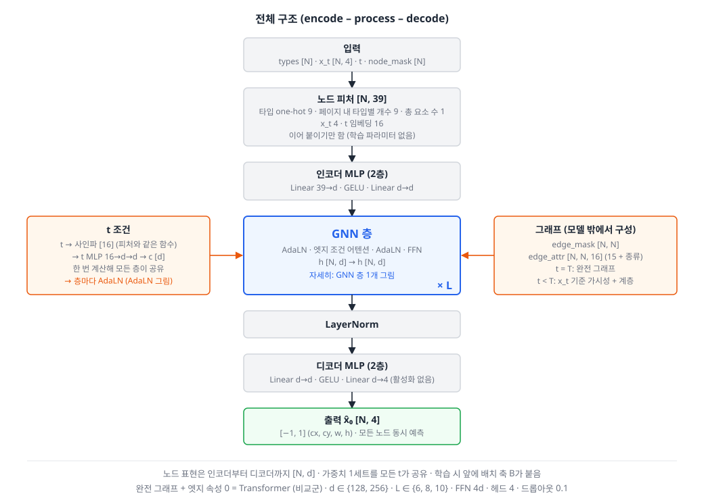
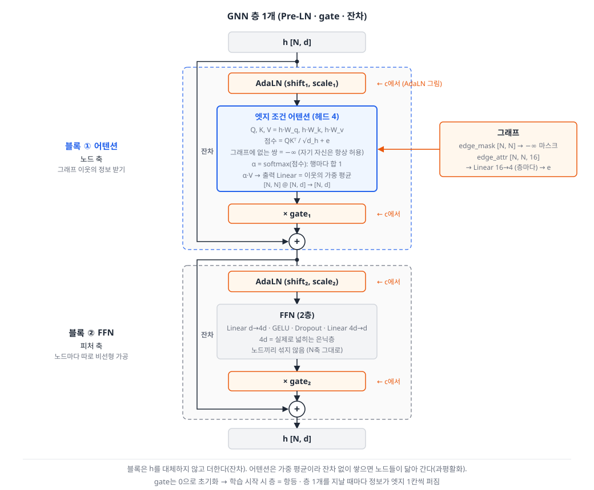
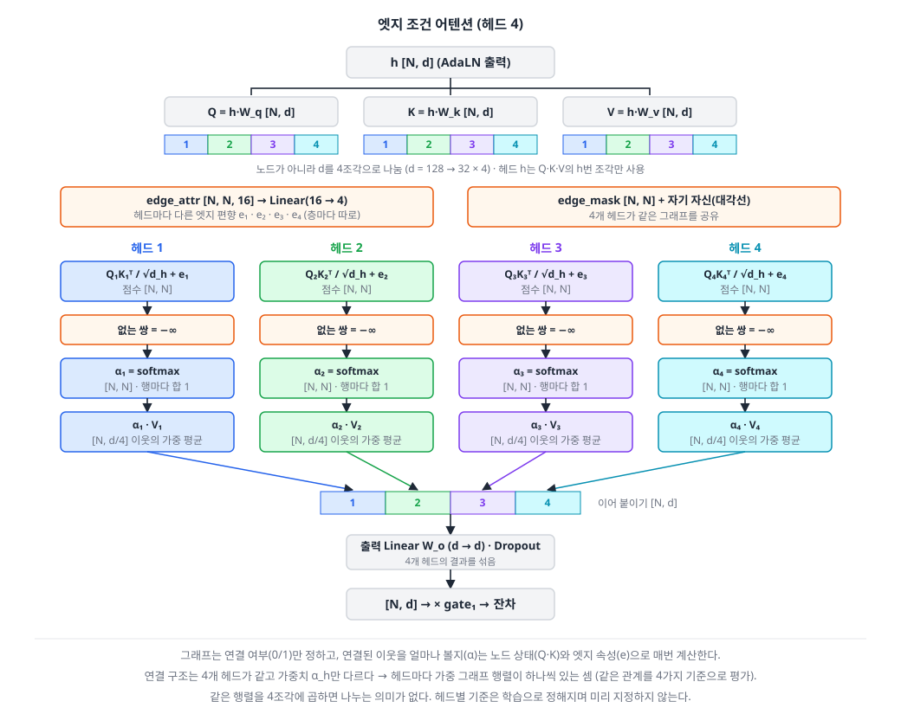
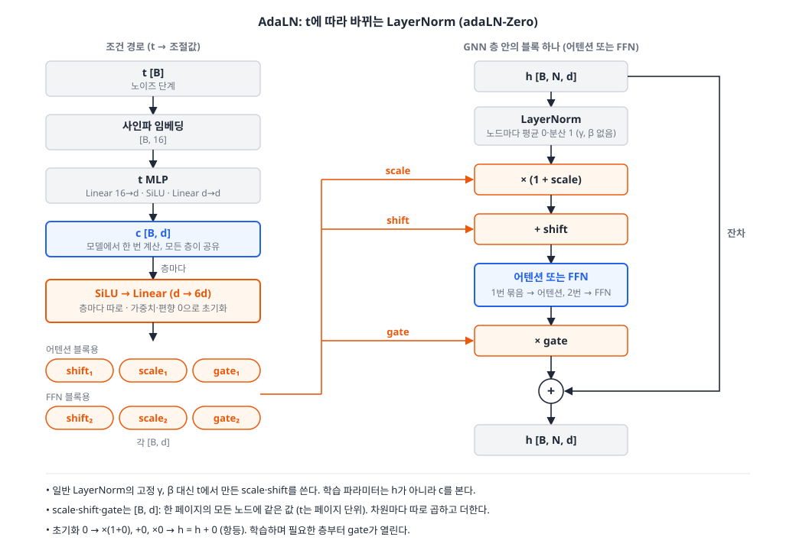

# 모델 설계: 관계 그래프 기반 GNN 디퓨전

> 주제·연구 질문·평가는 [README.md](README.md), 그래프 구성은 [graph.md](graph.md), 목적함수는 [obj-function.md](obj-function.md) 참고. 2026-11-05 ~ 11-08 논의 정리.

---

## 1. 개요



- **입력**: 순서 없는 타입별 개수 (`소제목 3, 본문 5, 그림 1`)
- **출력**: 노드별 x, y, w, h → [N, 4]
- **방식**: 무작위 좌표에서 시작해 같은 GNN을 T번 반복 호출하며 노이즈를 조금씩 제거 (DDIM)
- **그래프**: t = T일 때만 완전 그래프, t < T는 현재 노이즈 좌표 x_t 기준 가시성·계층 그래프

**왜 디퓨전인가**: 같은 타입 노드는 피처가 같고 정답(레이아웃)이 여러 개라, 일반 회귀 GNN은 정답들의 평균으로 뭉개진다. 노드마다 무작위 초기 좌표를 주고(같은 타입 노드를 구분하는 유일한 요소) 반복적으로 노이즈를 제거한다.

| 표기 | 의미 |
|---|---|
| x₀ | 정답 좌표 (DocLayNet 레이아웃) |
| x₁ ~ x_T | 노이즈 섞인 좌표 (숫자가 클수록 노이즈 많음, x_T는 완전 무작위) |
| x̂₀ | 모델이 예측한 정답 좌표 |

---

## 2. 디퓨전 원리

### 2.1 핵심 직관: 왜 여러 번 나눠서 이동하나

모델의 예측은 항상 **"현재 상태와 어울리는 정답들의 평균"**이다. 달라지는 것은 평균을 내는 대상이다.

| | 평균을 내는 정답들 | 결과 |
|---|---|---|
| **한 번에 이동** | 노이즈가 많은 시점이라 천차만별인 전체 정답 | 어느 정답도 아닌 평균 (뭉개짐) |
| **여러 번 이동** | 매 시점, 현재 상태와 비슷한 정답들 | 점점 특정 정답에 가까워짐 |



예: 본문 y좌표의 정답이 0.2(왼쪽 단)와 0.6(오른쪽 단) 두 개, 시작 좌표 0.9

```
예측 그대로 사용                          DDIM (조금씩)
t=50: 입력 0.9 → 예측 0.4 → 0.4로         t=50: 입력 0.9  → 예측 0.4  → 0.85로
t=49: 입력 0.4 → 50:50 → 예측 0.4         t=49: 입력 0.85 → 위쪽 치우침 → 예측 0.44
...   0.4에서 멈춤 (어느 정답도 아님)      ...   0.6으로 수렴
```

- 조금만 이동하면 초기 무작위 좌표의 **치우침(단서)**이 남아, 예측이 한쪽 정답으로 기울고 → 다음 이동도 그쪽으로 가는 되먹임이 생긴다.
- 즉 조금씩 이동하는 과정은 **평균을 내는 정답의 범위를 점점 좁혀가는 과정**이다.

### 2.2 학습: x_t에서 정답으로 한 번에



```
for 레이아웃 in 데이터:
    t = 무작위(1 ~ T)                              # 샘플마다 하나만 뽑음
    x_t = √ᾱ(t) × x₀ + √(1−ᾱ(t)) × ε               # 입력 좌표에만 노이즈를 섞음
    x̂₀ = GNN(x_t, t, 그래프)                        # 그래프는 graph.md
    손실 = 목적함수(x̂₀, x₀) → 역전파
```

#### 노이즈 섞기 식

```
x_t = √ᾱ(t) × x₀ + √(1 − ᾱ(t)) × ε
```

| 기호       | 의미                                        | 형태                                        |
| -------- | ----------------------------------------- | ----------------------------------------- |
| x₀       | 정답 좌표 (DocLayNet)                         | 노드별 (cx, cy, w, h)를 [−1, 1]로 정규화 → [N, 4] |
| ε        | 노이즈. 표준정규분포 N(0, 1)에서 뽑은 무작위 값            | [N, 4], 좌표마다 따로 뽑음                        |
| t / T    | 노이즈 단계 / 마지막 단계                           | 1 ~ T (T는 50에서 시작)                        |
| ᾱ(t)     | t단계에서 **정답이 남아 있는 비율**                    | 0~1. t가 커질수록 1 → 0                        |
| 1 − ᾱ(t) | t단계에서 **노이즈가 차지하는 비율** (노이즈 값을 뒤집는 것이 아님) | 0~1                                       |
| x_t      | 정답과 노이즈를 섞은 결과 = 모델 입력                    | [N, 4]                                    |

### 2.3 생성: DDIM으로 조금씩 이동

```
x_T ~ N(0, I)  (학습 ε와 같은 분포·공간, 타입·개수 고정)
for t = T, ..., 1:                                  # t는 반복문 카운터
    x̂₀ = GNN(x_t, t, 그래프)
    노이즈 성분 = (x_t − √ᾱ(t) × x̂₀) ÷ √(1 − ᾱ(t))
    x_{t-1} = √ᾱ(t−1) × x̂₀ + √(1 − ᾱ(t−1)) × 노이즈 성분
출력: x₀
```

- **노이즈를 다시 섞는 이유: 조금씩 이동하기 위해서.** 모델은 매 단계 최종 목적지 x̂₀를 한 번에 예측한다. 이를 그대로 쓰면 한 번에 이동하는 것과 같아 평균으로 뭉개진다. 그래서 x_t의 노이즈 성분을 t−1 비율만큼 다시 섞어 목적지 쪽으로 **일부만** 이동한 x_{t−1}에 멈추고, 다음 단계에서 그 자리에서 목적지를 다시 예측한다.
  - 식을 정리하면 x_{t−1} = a(t) × x_t + b(t) × x̂₀, 즉 현재 위치와 예측의 가중합이다. 새 노이즈를 뽑지 않는다.
  - 이동 비율 a(t), b(t)는 고정값(예: 1/T)이 아니라 스케줄 ᾱ에서 나온다. 그래야 x_{t−1}의 노이즈 양이 학습 때 본 t−1단계와 정확히 같아진다.
- **생성 중에 정답은 없다.** 섞는 것은 모델 예측 x̂₀와 현재 좌표의 노이즈 성분(초기 치우침이 담긴 부분)이다.
- **t는 측정값이 아니라 스케줄상 단계**다. x_T는 정의상 순수 노이즈이고, DDIM은 결과가 정확히 t−1 수준의 노이즈가 되도록 섞는다 → 매 단계 입력이 학습 때 본 x_{t-1}과 같은 형태.
- t가 클 때는 예측을 조금만, 작을수록 거의 그대로 반영한다. 생성 중 가중치는 업데이트하지 않는다.
- **예측을 그대로 쓰면 안 되는 이유**: ① 다음 입력이 학습 때 본 적 없는 형태(노이즈 없는 평균)가 되고, ② 같은 타입 노드가 한곳에 뭉쳐 다시 갈라지지 않는다.
- **단계 수**: DDIM은 재학습 없이 바꿀 수 있다. T = 1 / 5 / 10 / 50 비교 실험 (T = 1이면 평균으로 뭉개지는지 확인).

#### 시작값 x_T: 학습의 노이즈 ε와 같은 분포에서 뽑는다

학습(노이즈 추가)과 생성(노이즈 제거)은 방향이 반대지만, **학습이 도착하는 x_T와 생성이 출발하는 x_T는 같은 지점**이다.

```
학습:  x₀ ──────────→ x_T        x_T = √ᾱ(T) × x₀ + √(1 − ᾱ(T)) × ε
생성:  x₀ ←────────── x_T        ᾱ(T) = 0 이면 x_T = ε ~ N(0, I)
```

```python
eps = torch.randn_like(x0)     # 학습: 노이즈 뽑기
x_T = torch.randn(N, 4)        # 생성: 같은 분포에서 시작값 뽑기
```

이것이 성립하려면 두 조건을 **설계로 보장**해야 한다.

| 조건 | 이유 | 지키는 방법 | 확인 방법 |
|---|---|---|---|
| **ᾱ(T) = 0** | 흔한 스케줄은 ᾱ(T)가 0에 가깝지만 정확히 0이 아니라, 학습의 x_T에 정답 흔적이 남는다. 모델이 그 흔적에 의존하면 흔적이 없는 생성 x_T에서 성능이 떨어진다 (Lin et al., 2024) | 스케줄을 재조정해 ᾱ(T) = 0 (zero terminal SNR). x̂₀를 예측하는 구조라 ᾱ(T) = 0에서도 문제없음 (ε 예측 방식은 문제가 생김) | 코드에서 ᾱ(T) 값 출력 |
| **같은 분포·같은 공간** | 다른 분포에서 뽑으면 모델이 처음 보는 입력을 받는다 | 학습 ε와 **같은 샘플링 함수**로, [−1, 1] 정규화된 (cx, cy, w, h) 공간에서 표준정규분포로 뽑는다. 균등분포나 페이지 좌표 [0, 1]에서 뽑지 않는다 | 학습 코드로 만든 x_T의 평균 0·분산 1 확인 |

- **x_T 분포를 저장해 둘 필요는 없다.** ᾱ(T) = 0이면 x_T ~ N(0, I)로 식에서 정확히 정해진다. (ᾱ(T) ≠ 0이면 x_T 분포가 데이터에 따라 달라져 추정이 필요해지므로, ᾱ(T) = 0으로 이 문제를 없앤다)
- **1 − ε가 아니다.** 1 − ε는 평균이 1인 분포라 학습 x_T(평균 0)와 어긋난다. "1 −"는 비율 1 − ᾱ(t)에 붙는 것이다.
- **중간 단계 x_t는 뽑지 않는다.** 중간 x_t 분포는 데이터에 따라 달라 식으로 알 수 없지만, 생성은 x_T만 뽑고 나머지는 DDIM이 만든다.
- t = T의 그래프는 좌표와 무관한 완전 그래프라 그래프 쪽 불일치도 없다.

### 2.4 학습 1번 · 생성 T번이 맞물리는 이유

| | 순전파 | 역전파 | 그래프 구성 |
|---|---|---|---|
| 학습 | 샘플당 1번 | 1번 | 1번 |
| 생성 | T번 | 없음 | T번 |

- 역할 분리: **정답 추정은 모델**, **조금씩 이동은 고정 공식(DDIM)**. 학습은 모든 t를 고르게, 생성은 그 t들을 순서대로 밟는다.
- **노출 편향**: DDIM은 "예측 = 정답"을 가정하므로 예측 오차만큼 입력이 학습 분포에서 벗어나 누적될 수 있다. 필요하면 self-conditioning([graph.md](graph.md) 3.2절), 학습 노이즈 섭동, 단계 수 조절로 대응.

---

## 3. 입력

### 3.1 모델 입출력

```
x̂₀ = GNN(타입, x_t, t, 그래프)
```

| 입력 | 형태 | 학습 때 | 생성 때 | 역할 |
|---|---|---|---|---|
| 노드 타입 | [N] | DocLayNet `category_id` | 사용자 입력 (타입별 개수) | 노드가 무엇인지 |
| 노드 개수 N | 노드 수 | 페이지의 요소 수 | 타입별 개수의 합 | 그래프 크기, 전역 피처 |
| 좌표 x_t | [N, 4] | 정답 x₀에 노이즈를 섞음 | N(0, I)에서 시작, 이후 직전 단계 결과 | 현재 배치 상태 |
| 단계 t | 스칼라 | 1 ~ T 무작위 | T → 1 | 노이즈 양. 같은 x_t도 t에 따라 다르게 예측 |
| 그래프 | [N, N], 엣지 속성 [N, N, 15] | x_t로 매 스텝 구성 | x_t로 매 단계 구성 | 노드 관계 ([graph.md](graph.md)) |

| 출력 | 형태 | 비고 |
|---|---|---|
| x̂₀ | [N, 4] | 노드별 (x, y, w, h). 모든 노드를 한 번에 예측 |

- 정답 x₀(DocLayNet `bboxes`)는 x_t를 만들고 손실을 계산하는 데만 쓰고, 그대로 입력에 넣지 않는다.
- 학습 샘플 단위는 **페이지**. 배치는 페이지를 쌓아 [B, N, …]로 만들고 패딩은 mask [B, N]로 제외한다.
- **입력에서 제외**: 문서 종류(`doc_category`, 조건 미사용), 콘텐츠(텍스트·글꼴), 정답에서 계산한 값(넓이 등).

### 3.2 노드 피처 (39차원)

| 구분      | 피처              | 차원    |
| ------- | --------------- | ----- |
| 노드 (고정) | 타입 one-hot      | 9     |
| 전역 (고정) | 페이지 내 타입별 개수 | 9 |
| 전역 (고정) | 총 요소 수 | 1 |
| 현재 상태   | x_t의 x, y, w, h | 4     |
| 현재 상태   | t 임베딩 (사인파)     | 16    |

- 타입 차원(9)은 타입 구성 확정 시 바뀐다 (DocLayNet 원본은 11종).
- **제외**: 중요도·종횡비(정답에서 계산 → 유출), 읽기 순서(입력에 없음), 텍스트 분량·단락 여부(콘텐츠 미입력), 트리 깊이·자식 수(계층 엣지와 중복), 문서 종류(`doc_category`, 조건 미사용)
- 기준: **노이즈 좌표나 모델 예측에서 계산한 값은 사용 가능, 정답 좌표에서 계산한 값은 불가.**

---

## 4. GNN 구조

### 4.1 전체 구조



- **encode – process – decode**: 인코더 MLP가 노드 피처 39차원을 d로 바꾸고, GNN 층 L개가 노드 표현 [N, d]를 이웃 정보로 갱신하고, LayerNorm과 디코더 MLP가 d를 좌표 4로 바꾼다. 디코더 출력에는 활성화가 없다 (x̂₀는 [−1, 1]의 cxcywh 공간).
- **노드 피처 조립**은 모델 forward 안에서 한다. `types`, `x_t`, `t`, `node_mask`만 있으면 항상 같은 값이 나오므로, 학습과 생성이 같은 입력을 넣으면 피처도 자동으로 같아진다.
- **층 밖에서 들어오는 입력 두 가지**
  - **t 조건 c**: t의 사인파 임베딩을 t MLP에 통과시켜 한 번 계산하고 모든 층이 공유한다. 층마다 AdaLN으로 들어간다 (4.4).
  - **그래프**: `edge_mask`, `edge_attr`. x_t와 t로 **모델 밖에서** 만든다 (5절). 모델은 그래프를 어떻게 만들었는지 모르므로, 완전 그래프 마스크와 엣지 속성 0을 넣으면 그대로 Transformer 비교군이 된다.
- **t는 두 곳에 들어간다**: 입력 피처(인코더가 처음부터 노이즈 양을 앎)와 층마다 AdaLN(깊은 층도 t를 직접 봄).
- **가중치는 1세트**를 모든 t가 공유한다. 단계마다 다른 모델이 아니라, 같은 모델이 t에 따라 다르게 동작한다. 그래서 생성 단계 수를 재학습 없이 바꿀 수 있다.

### 4.2 GNN 층 1개



```
h = h + gate₁ × 어텐션(AdaLN₁(h), 그래프)      ① 노드 축: 이웃 정보 받기
h = h + gate₂ × FFN(AdaLN₂(h))                 ② 피처 축: 노드별 비선형 가공
```

- **블록 ① 엣지 조건 어텐션 (그래프 연산)**: 그래프 이웃의 정보를 가중 평균으로 모은다. 자세한 구조와 헤드는 4.3.
- **블록 ② FFN**
  - Linear d→4d · GELU · Dropout · Linear 4d→d. 4d는 실제로 넓히는 은닉층이다 (탐색하지 않고 고정).
  - 노드끼리 정보를 주고받지 않고, ①에서 모은 정보를 노드 안에서 비선형으로 조합한다. 층 파라미터의 대부분(약 8d²)을 차지한다.
- **잔차**: 블록 출력으로 h를 대체하지 않고 더한다.
  - 어텐션은 평균이라 잔차 없이 쌓으면 층마다 노드들이 닮아 간다 (과평활화). 그러면 같은 타입 노드를 구분하는 유일한 단서인 x_t의 치우침이 지워져 같은 좌표로 뭉친다.
  - 기울기가 지름길로 앞층까지 전달되어 깊은 층(L = 10, 블록 20개)도 학습된다.
  - 각 블록은 새 h 전체가 아니라 "h를 얼마나 고칠지"만 배운다.
- **층 1개 = 엣지 1칸 전달**: L층이면 L칸 떨어진 노드까지 닿는다. L 후보를 그래프 지름으로 정하는 이유다 (4.5).

### 4.3 엣지 조건 어텐션과 헤드



```
α[h, i, j] = softmax_j( Q_h(i) · K_h(j) / √d_h + e_h(i, j) )      헤드 h에서 노드 i가 이웃 j를 보는 비율
출력_i    = W_o · [ Σ_j α[1,i,j] V_1(j) | … | Σ_j α[4,i,j] V_4(j) ]
```

**어텐션**
- 점수 = QKᵀ/√d_h + e. e는 엣지 속성 16차원을 층마다 `Linear(16 → 4)`로 바꾼 헤드별 편향이다. 거리·방향 같은 관계가 "누구를 얼마나 볼지"를 바꾼다.
- 그래프에 없는 쌍은 −∞로 막는다. 자기 자신(대각선)은 항상 허용한다 (이웃이 없는 노드·패딩 노드에서 softmax가 NaN이 되는 것을 막음).
- softmax 가중치는 0 이상이고 합이 1이라 출력은 **이웃 값의 가중 평균**이다. 평균이라 이웃 수가 2개든 15개든 출력 크기가 일정하다. 가중치는 쌍마다 계산되므로 균등 평균은 아니다.
- 이웃 j의 정보를 가중치 α_ij로 모아 i를 갱신하는 메시지 패싱을 어텐션으로 구현한 것이다 (GAT 계열).
- **그래프는 외부 입력인데 학습이 필요한 이유**: 그래프는 누구와 연결됐는지(0/1)만 정한다. 연결된 이웃을 얼마나 볼지(α)는 학습한 W_q, W_k, 엣지 편향으로 매번 계산한다. 학습하는 것은 α 값이 아니라 α를 계산하는 방법이므로, 같은 그래프라도 노드 상태·t·층에 따라 α가 달라진다.
- **고정 인접행렬(GCN)과의 차이**: 둘 다 [N, N] @ [N, d] 행렬곱이지만, 고정 행렬은 모든 이웃이 같은 비중이고 엣지 속성을 쓸 곳이 없다. 완전 그래프(t = T)에서는 모든 칸이 1/N이라 모든 노드가 똑같은 전체 평균을 받는다.

**헤드 (4개)**
- 노드가 아니라 **d를 나눈다** (d = 128 → 32 × 4). Q·Kᵀ에서 d/4는 내적으로 사라지므로 점수는 항상 [N, N]이고, 모든 헤드가 같은 그래프 전체를 본다.
- 헤드마다 W_q, W_k, W_v, e가 따로라 비율표 α_h가 다르다. **연결 구조(마스크)는 같고 연결된 칸의 가중치만 다른 "가중 그래프 행렬"이 헤드마다 하나씩** 있는 셈이다. 출력의 d/4 조각마다 이웃을 다른 비율로 섞고, 출력 Linear W_o가 4개 조각을 합친다.
- **나누는 이유**: softmax 하나는 이웃 비율을 하나만 만든다. 헤드가 여럿이면 같은 관계를 여러 기준으로 평가할 수 있다 (예: 위쪽 제목 / 옆 그림 / 같은 타입). 같은 행렬을 4조각에 곱하면 A·[V₁|…|V₄] = A·V라 나누는 의미가 없으므로, 비율표가 헤드마다 다르다는 점이 핵심이다.
- 조각은 원래 피처를 자른 것이 아니라 V = h·W_v로 변환한 뒤 자른 것이다. 헤드 4개는 [d, d/4] 변환을 각자 가진 작은 어텐션 4개와 같고, 각 조각에 무엇을 담을지는 학습이 정한다. 기준을 미리 지정하지 않으며, 4개가 모두 다른 관계를 본다는 보장도 없다.
- **헤드 수는 엣지 종류 수(2)와 무관하다.** α는 엣지 종류만이 아니라 노드 상태와 엣지 속성 16차원으로 계산되고, 같은 가시성 엣지 안에서도 볼 것이 여러 가지다. 엣지 종류별로 헤드를 나누는 것은 관계별 어텐션(R-GAT 계열)이라는 다른 설계다.
- 학습 전 α는 관계와 무관한 값이다. 손실을 줄이는 관계를 반영하도록 학습되며, 초반의 무작위 α는 gate = 0이라 결과에 반영되지 않는다. **학습 후 α를 엣지 종류·방향·헤드별로 평균 내어** 모델이 실제로 관계를 사용했는지 확인한다 (연구 질문 2의 보조 근거).
- 4개 분리가 이 과제에 도움이 되는지는 실험 전에는 알 수 없다. 사전 점검 방법은 4.5.

### 4.4 AdaLN



```
shift₁, scale₁, gate₁, shift₂, scale₂, gate₂ = Linear(SiLU(c))     각 [B, d]
AdaLN(h) = LayerNorm(h) × (1 + scale) + shift
```

- **t에 따라 바뀌는 LayerNorm**이다. 일반 LayerNorm의 고정 γ, β 대신 c에서 만든 scale·shift를 쓴다. h를 직접 가공하는 MLP가 아니라, h는 정규화 후 차원마다 곱하고 더하기만 한다. Linear는 c에서 조절값을 만드는 데만 쓴다.
- **왼쪽(생성)**: `Linear(d → 6d)`는 차원을 넓히는 것이 아니라 d차원 값 6개(블록당 3개 × 블록 2개)를 한 번에 만든다. Linear 6개와 같고, 층마다 따로 둔다.
- **오른쪽(사용)**: scale·shift는 블록 입력을 조절하고, gate는 블록 출력을 얼마나 더할지 정한다.
- **페이지 단위 값**: 조절값은 [B, d]라 한 페이지의 모든 노드에 같은 값이 쓰인다. 노드끼리의 차이는 h에서 온다.
- **입력 피처의 t만으로 부족한 이유**: 입력에만 넣으면 t 정보가 층을 지나며 잔차로 더해지는 다른 정보에 묻힌다. 큰 t에서 "무작위에 가까운 엣지를 덜 믿는" 판단은 어텐션 층마다 필요하므로, 층마다 t를 직접 넣는다 (DiT 방식).
- **adaLN-Zero 초기화**: Linear의 가중치·편향을 0으로 시작한다. scale = shift = gate = 0이라 모든 층이 h = h + 0(항등)으로 시작하고, 학습하며 필요한 층부터 gate가 열린다.

### 4.5 하이퍼파라미터 후보

| 항목 | 후보 | 근거 |
|---|---|---|
| 은닉 차원 d | **128, 256** | 7만 페이지 규모에 무난. 헤드 수(4)로 나누어떨어짐 |
| GNN 층 수 L | **6, 8, 10** | 층 1개 = 1칸 전달. 그래프 지름만큼 층이 있어야 양 끝 노드가 닿음 (한 줄 그래프면 N − 1). 실제 지름은 측정으로 확인 |

| 파라미터 수 (대략) | L = 6 | L = 8 | L = 10 |
|---|---|---|---|
| d = 128 | 1.6M | 2.2M | 2.7M |
| d = 256 | 6.5M | 8.6M | 10.7M |

**선택 절차**
1. 기본 설정(복원 손실만 + 가시성·계층 그래프)으로 6가지 조합을 학습한다. 부담되면 짧게 돌려 하위 조합을 먼저 뺀다.
2. 미리 정한 모델 선택 지표로 하나를 고른다. 차이가 작으면 작은 쪽을 고른다.
3. 이후 모든 비교 실험(그래프 ablation, 목적함수 ①②③)에서 **고정**한다.

- 인코더·디코더(2층 MLP), FFN 확장 비율(4d), 헤드 수(4)는 탐색하지 않고 고정한다. 탐색 자원은 그래프가 작동하는 L에 쓴다.
- **헤드 수 사전 점검**: 다중 헤드가 대체로 유리하고 파라미터 수가 거의 같아 비용이 없으므로 4로 시작한다 (d_h = d / 4: d = 128 → 32, d = 256 → 64). 본 실험 전에 헤드 1 / 2 / 4를 같은 조건으로 짧게 학습해 검증 손실을 비교하고, 차이가 없으면 4를 유지한다. 헤드 수는 d가 나누어떨어지기만 하면 되며, 보통 d_h = 32 ~ 64가 되도록 정한다.
- **그래프 지름 측정**: 정답 x₀로 가시성·계층 그래프를 만들어 페이지별 지름 분포를 본다 (분석용이라 정답 사용 가능). "95% 페이지의 지름이 k 이하"를 L 후보의 근거로 쓴다.
- **가상 노드 (선택)**: 지름이 긴 페이지(단일 단에 블록이 세로로 쌓인 경우 등)가 많으면 모든 노드와 연결된 가상 노드를 추가해 2칸 만에 전체가 닿게 한다. 넣으면 ablation에 "가상 노드 있음 / 없음"을 추가해 관계 그래프 효과와 구분한다.
- 층이 지름보다 적어도 생성 시 T번 반복하며 매번 그래프를 다시 만들어 정보가 점차 퍼지지만, 단계별 예측이 흔들리고 수렴이 느려질 수 있다.

---

## 5. 그래프 구성

> 상세 결정 근거, 개선안, 제외한 방식, ablation은 **[graph.md](graph.md)** 참고.

| 단계 | 그래프 |
|---|---|
| t = T | 완전 그래프 (관계를 알 수 없는 시점) |
| t < T | 현재 노이즈 좌표 x_t 기준 가시성 + 계층 |

- 학습과 생성에 똑같이 적용하며 확률로 섞지 않는다. 정답 x₀로는 그래프를 만들지 않는다 (정답 유출).

---

## 6. 목적함수

> 상세 설계와 실험 계획은 **[obj-function.md](obj-function.md)** 참고.

```
L = L_복원 + λ_겹침(t) × L_겹침 + λ_이탈 × L_이탈 + λ_정렬(t) × L_정렬
```

- 출력을 노이즈 ε가 아니라 좌표 x̂₀로 직접 예측하므로 기하 손실을 바로 적용할 수 있다.
- 손실 가중치는 항마다 따로 둔다. 겹침·정렬은 ᾱ(t)로 t에 따라 바꾸고, 이탈은 고정.
- 실험 3가지: ① L_복원만 / ② + 기하 손실(고정 손실 가중치) / ③ + 기하 손실(겹침·정렬에 ᾱ(t) 적용)

---

## 7. 구현 할 일

- [ ] 피처 재구성 (39차원, t 임베딩은 입력 + 층마다 AdaLN)
- [ ] 그래프 지름 측정 (정답 x₀ 기준) → L 후보 근거, 가상 노드 필요 여부
- [ ] GNN 구현: 인코더·디코더 MLP, 엣지 조건 어텐션 + AdaLN 층, 완전 그래프 마스크로 Transformer 비교군 겸용
- [ ] d ∈ {128, 256} × L ∈ {6, 8, 10} 선택 후 고정
- [ ] 노이즈 스케줄 ᾱ(t) 구현 (cosine 스케줄로 시작, **ᾱ(T) = 0이 되도록 재조정**)
- [ ] 노이즈 샘플링 함수 하나를 학습 ε·생성 x_T에 공유, x_T 평균·분산 확인
- [ ] 그래프 구성: 완전 그래프 + 엣지 종류 플래그, `generate_adj.py`·`generate_attr.py`를 x_t 입력으로 호출
- [ ] 학습 코드 수정 (다단계 노이즈 + t 임베딩 + t에 따른 그래프 선택 + 배치 마스크)
- [ ] 목적함수 실험 ①②③ 구현 ([obj-function.md](obj-function.md) 3절)
- [ ] DDIM 기반 반복 생성 루프 구현 (단계 수 가변)
